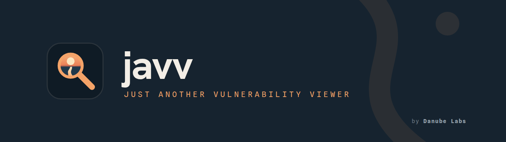
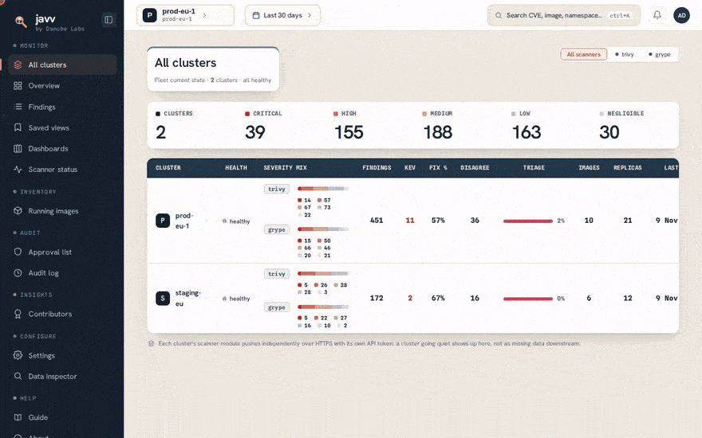
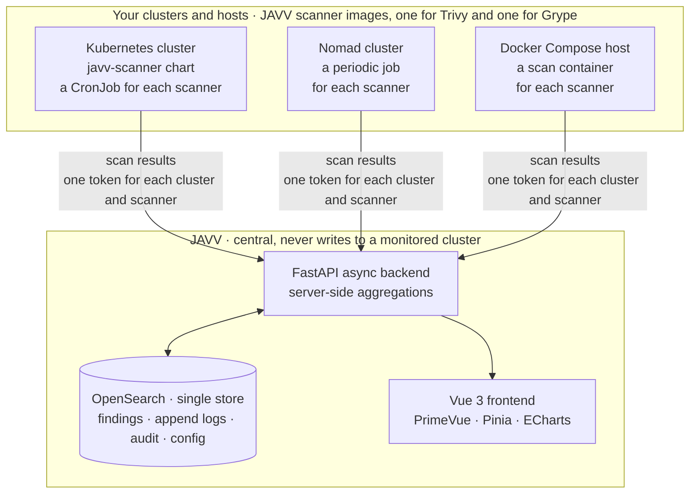

  

  
  
  
  
  

  <b>Container-vulnerability triage for what runs in your Kubernetes clusters.</b> 
  JAVV also scans Nomad clusters and Docker Compose hosts. It finds the images that
  <i>actually run</i> and scans them with <b>Trivy and Grype</b>, side by side. Each
  vulnerability gets <b>its own triage lifecycle with an audit trail</b>: who changed what, and
  when. JAVV also gives you dashboards, time travel over the whole app and CSV export, without the
  weight of a full ASPM platform. An <b>AI agent</b> can read and triage the findings through the
  MCP endpoint.

  <a href="https://danube-labs.github.io/javv/latest/"><b>Docs</b></a> ·
  <a href="REPO-MAP.md">Repo map</a> ·
  <a href="development/RUNNING-THE-STACK.md">Run the stack</a> ·
  <a href="docs/API.md">API</a> ·
  <a href="docs/CONFIGURATION.md">Configuration</a> ·
  <a href="docs/engineering/ARCHITECTURE.md">Architecture</a>

  

  
    The fleet · the findings of one cluster · one CVE, with the evidence of each scanner and its
    own audit trail · the approvals queue · the audit log. Made-up data from two clusters.
  

---

## Why

Vulnerability tools are in two groups. **Triage tools** (DefectDojo, Dependency-Track) have a
triage lifecycle, but their reports are rigid. **Log dashboards** have flexible reports, but no
audit of a finding. JAVV gives you both: a real triage lifecycle *and* dashboards that you build,
over what runs in your clusters now.

What JAVV gives you:

- **Two scanners, never merged.** Trivy and Grype scan each image, and their results stay side by
  side. JAVV keeps the CVE of each scanner, also when the other scanner reports it too. It **flags where they
  disagree**, so you see what one scanner alone misses.
- **Dashboards that you build.** Make your own dashboards from a catalog of panels. Share each
  dashboard with everyone or with some roles. Copy a dashboard to a different JAVV as a file.
- **Triage of many findings at once.** Filter the findings, then change the state of all the
  matching findings in one step. JAVV adds your note to each finding. The audit log records the
  change.
- **CSV exports for your reports.** Export the findings, the audit log, the contributors and the
  approvals queue as CSV files. For a file that is too large, make an export report.
- **An MCP server for AI agents.** Connect an agent such as Claude Code or Codex. The agent reads
  and triages the findings. Each MCP token has one level: read, write, or write and risk accept.
  The audit log records each tool call.

## Where JAVV scans

Kubernetes is the main target. JAVV also scans Nomad clusters and Docker Compose hosts, and it
takes results from your own script. Each source uses the same JAVV scanner images.

| Source | How the scans run | Guide |
|---|---|---|
| **Kubernetes** | The `javv-scanner` Helm chart in each cluster runs one CronJob for each scanner. You choose what to scan by namespace, image and workload kind. For a private registry, the chart mounts a registry login. | [Deploying](docs/DEPLOYING.md) |
| **Nomad** | Two periodic Nomad jobs, one for each scanner, scan the images of the running allocations. JAVV shows the Nomad cluster as a cluster. | [Scan a Nomad cluster](deploy/nomad/README.md) |
| **Docker Compose host** | Two scan containers read the running containers from the Docker socket and scan each image every 6 hours. Each Compose project shows as a namespace. | [Scan a Docker Compose host](deploy/docker/README.md) |
| **Your own script** | Your script sends scan results to the ingest API. | [Push from your own script](docs/INGEST-CONTRACT.md) |

## Features

- **Runtime discovery**: JAVV scans the images that run now. On Kubernetes, you choose what to scan by namespace, image and workload kind.
- **Two scanners, side by side**: the results of Trivy and Grype stay apart. JAVV shows where they disagree and never merges them.
- **An audit trail for each finding**: each triage change, decision and note records who, what and when.
- **Triage lifecycle**: six states. You set five of them, and JAVV sets `stale` when no scan reports a finding for some days. VEX export (OpenVEX and CycloneDX), risk acceptance with an expiry, and decisions that apply to both scanners.
- **Time travel**: one picker shows *each* screen as it was at a time in the past.
- **Audit log**: each change, for each finding and each user. You can export it as CSV.
- **Clusters and roles**: the data of each cluster stays apart. The role of each user decides what the user can do. Local sign-in, with a first admin account.
- **Screens and exports**: overview, running images, scanner status, contributors, approvals, SLA tracking and CSV export.
- **Dashboards**: make your own dashboards from a catalog of panels. Share each one with everyone or with some roles, and copy dashboards to a different JAVV as a file.
- **AI agents (MCP)**: connect an agent such as Claude Code, Codex, VS Code or Cursor to the MCP endpoint of JAVV. Each MCP token has one level: read, write, or write and risk accept. No token can change users, roles, settings or tokens, or delete data. Each tool call writes a row in the audit log. The endpoint is off by default ([Use the MCP server](docs/use/use-the-mcp-server.md)).
- **Data inspector and repair actions**: a read-only view of the data in OpenSearch, and a small set of maintenance jobs. The audit log records each job run.

## Architecture

Each scanner pushes its results with a token for **one cluster and one scanner**. A token cannot
push the data of a different cluster. JAVV only receives pushes. It needs no credentials for the
clusters that it reports on, and no network path into them.

The layers, the data flow and the index model are in
[`docs/engineering/ARCHITECTURE.md`](docs/engineering/ARCHITECTURE.md) and
[`docs/engineering/INDEX-MAP.md`](docs/engineering/INDEX-MAP.md).

## Running it

JAVV itself runs in one of two ways:

- **On one machine:** [`deploy/compose/`](deploy/compose/) starts OpenSearch, the backend and the
  frontend with `docker compose up -d`, on the images that the release publishes.
- **On Kubernetes:** the `javv-opensearch` and `javv` Helm charts.

Then connect the scanners of each source (see [Where JAVV scans](#where-javv-scans)). The guide,
with http or https and the scanner connection, is **[`docs/DEPLOYING.md`](docs/DEPLOYING.md)**. It
is also on the [docs site](https://danube-labs.github.io/javv/latest/), with configuration, sizing,
upgrades and the API.

**From source**, for development: start the stack by hand with
**[`development/RUNNING-THE-STACK.md`](development/RUNNING-THE-STACK.md)** (paths A, B and F). You
can run the backend and the UI on a local OpenSearch, or the full path with real Trivy and Grype
scans of a k3d cluster. On a new Ubuntu host, `bash development/setup/setup-dev.sh` installs each
prerequisite first. You can run it again with no change. `preflight.sh` checks that the host is
ready.

## Documentation

**The docs site: <https://danube-labs.github.io/javv/latest/>**. It has these parts:

- **Use JAVV:** the tasks of each day, each with a short video, and the MCP server.
- **Install:** deploying, the charts, and the pages "Scan a Nomad cluster" and "Scan a Docker
  Compose host".
- **Configure, operate and upgrade:** the settings, sizing, scaling, the data, and the release
  notes.
- **Integrate:** the API, and "Push from your own script".

Each release has its own version of the docs. The [`dev`](https://danube-labs.github.io/javv/dev/)
version shows the files on `main`.

**Canonical engineering set ([`docs/engineering/`](docs/engineering/)):**

| Doc | What |
|---|---|
| [PLAN.md](docs/engineering/PLAN.md) | Decisions, data model, milestones |
| [SPEC.md](docs/engineering/SPEC.md) | Functional + non-functional requirements (FR/NFR) |
| [ARCHITECTURE.md](docs/engineering/ARCHITECTURE.md) | Layers, data flow, diagrams (Mermaid) |
| [INDEX-MAP.md](docs/engineering/INDEX-MAP.md) | Source of truth for every OpenSearch index + mapping |
| [FLOW-EXAMPLE.md](docs/engineering/FLOW-EXAMPLE.md) | Worked ingest / query / time-travel examples |
| [AUDIT-RESPONSE.md](docs/engineering/AUDIT-RESPONSE.md) | External-audit findings and their resolutions |

**Supporting:**

| Path | What |
|---|---|
| [REPO-MAP.md](REPO-MAP.md) | **Repository map**: what every folder is + reading order |
| [CONTRIBUTING.md](CONTRIBUTING.md) | Setup, house conventions, the gates a PR must pass |
| [SECURITY.md](SECURITY.md) | How to report a vulnerability in JAVV (privately), and what's in scope |
| [CODE_OF_CONDUCT.md](CODE_OF_CONDUCT.md) | Contributor Covenant 3.0: the rules of conduct, and how to report a concern |
| [docs/API.md](docs/API.md) | The shipped HTTP surface at a glance (auth regimes, capabilities) |
| [docs/DEPLOYING.md](docs/DEPLOYING.md) | Deploy JAVV: docker compose on one machine or the Helm charts on Kubernetes, and connect the scanners |
| [deploy/nomad/](deploy/nomad/README.md) · [deploy/docker/](deploy/docker/README.md) | Scan a Nomad cluster, or a Docker Compose host |
| [docs/UPGRADING.md](docs/UPGRADING.md) | Move a running JAVV to a newer release |
| [docs/CONFIGURATION.md](docs/CONFIGURATION.md) | Every configuration setting: its default, what it does, where you set it |
| [development/RUNNING-THE-STACK.md](development/RUNNING-THE-STACK.md) | Start the stack by hand (backend, full stack or frontend) |
| [docs/research/](docs/research/) | The research behind the design: stack practices, tools for agents, audits |
| [design/](design/) | Brand source of record (logos, tokens, guide) |

## Stack & toolchain

Python 3.12 · FastAPI (async) · AsyncOpenSearch · Pydantic v2 · Vue 3 (`<script setup>`) · PrimeVue ·
Pinia · vue-echarts. OpenSearch is the single store. Open-source components throughout.

The versions of the gate tools decide the lint, type and test results, so that a local run gives
the result of CI. Their pins are in **[`versions.yaml`](versions.yaml)**. Change a version there.
`development/setup/setup-dev.sh` reads that file, and `development/scripts/check-versions.sh`
compares each copy with it.

| Tool | Role | Version |
|---|---|---|
| Python | Backend runtime | 3.12 |
| [uv](https://docs.astral.sh/uv/) | Python package/venv manager | `toolchain.uv` in [`versions.yaml`](versions.yaml) |
| [ruff](https://docs.astral.sh/ruff/) | Lint + format (backend) | `toolchain.ruff` in [`versions.yaml`](versions.yaml) |
| [pyright](https://microsoft.github.io/pyright/) | Type check (backend) | `toolchain.pyright` in [`versions.yaml`](versions.yaml) |
| Node.js | Frontend runtime / toolchain | `toolchain.node` in [`versions.yaml`](versions.yaml) |
| Vite · Vitest · ESLint/oxlint · stylelint · vue-tsc | Build, tests, lint/type gates (frontend) | from [`frontend/package.json`](frontend/package.json) |
| OpenSearch | Single datastore | pinned in [`versions.yaml`](versions.yaml) |
| [Trivy](https://trivy.dev/) · [Grype](https://github.com/anchore/grype) | Scanners (per-scanner, never merged) | pinned in [`versions.yaml`](versions.yaml) |
| kubectl · helm · [k3d](https://k3d.io/) | Local k8s (k3s-in-Docker) | latest |

### Supported versions

The versions of the scanners and of OpenSearch that JAVV supports are in
[`versions.yaml`](versions.yaml). Renovate watches that file. The **compatibility gate** in CI
(`scanner-images`) checks a new scanner version before its image publishes. A drift check keeps
the Dockerfiles and the dev compose file equal to it. To change the support, change
`versions.yaml`.

<!-- --8<-- [start:supported-versions] -->
| Component | Current | Also supported |
|---|---|---|
| Trivy | 0.76.2 | 0.70.0 |
| Grype | 0.121.1 | 0.114.0 |
| OpenSearch | 3.9.0 | n/a |
<!-- --8<-- [end:supported-versions] -->

Each supported scanner version has its own image:
`ghcr.io/danube-labs/javv-scanner-{trivy,grype}:<ver>`. To change the scanner version, change the
image tag in your deployment. JAVV never changes a version in a running cluster. Each published
image has a cosign keyless signature and a signed SBOM attestation:
[how to check one](scanner/README.md#verify-a-published-image).

## License

JAVV is **source-available** under the [Business Source License 1.1](LICENSE):

- **Free to use, change and host yourself**, also in production, for any team or company.
- **What you may not do:** offer JAVV itself to third parties as a hosted/managed service (i.e. sell JAVV-as-a-service).
- **Time-delayed open source:** on the Change Date (**2030-06-10**) this version automatically converts to the **Apache License 2.0**.

Bundled/invoked tools (Trivy, Grype, OpenSearch) remain under their own Apache-2.0 licenses with
attribution. For other licensing arrangements, contact Danube Labs.
