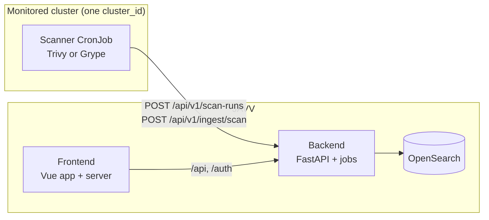

# System patterns

The architecture in short, and the decisions that still apply. The full text is in
[`docs/engineering/ARCHITECTURE.md`](../../docs/engineering/ARCHITECTURE.md) and
[`docs/engineering/PLAN.md`](../../docs/engineering/PLAN.md) section 3. When this file and those
files do not agree, those files are correct.

## The flow

1. The scanner runs as a CronJob in each monitored cluster. It finds the running images, asks the
   backend for a scan order and the scan scope, scans each digest once, and pushes the results.
2. The backend checks the envelope, appends the occurrences and images, commits the scan, and then
   merges the `findings` cache.
3. The backend runs its own background jobs on cron schedules (D47).
4. The frontend server serves the app and sends `/api`, `/auth` and `/readyz` to the backend.
5. Each count and page comes from an OpenSearch query or aggregation.

## Data patterns

The rules for code are in [`.claude/rules/data-model.md`](../../.claude/rules/data-model.md). Each
index and its mapping is in [`docs/engineering/INDEX-MAP.md`](../../docs/engineering/INDEX-MAP.md).

- **Two layers.** `findings` is the current state (updated in place). The append logs
  (`javv-scan-events`, `javv-finding-occurrences`, `javv-images`) keep the history (D2, D2b, D29).
- **Read through the commit catalog** (D37). Read the latest committed run, then its occurrences.
  Never read "the latest document for each key".
- **Order by `scan_order`, never by a clock** (D40, D45). The backend gives each scan its order.
- **A watermark guards each create and update of a finding** (D40).
- **Commit, then cache.** Append, commit, and then merge `findings`. A finding that a run did not
  report gets `present=false` in the cache. The history keeps no deletes.
- **Human decisions are their own layer** (D3, D4). `system-decisions` holds risk accepts, ignore
  rules and `not_affected`. The triage state on a finding is a projection of them (D17). A decision
  never changes: an edit is a revoke and a create.
- **Each human change writes a structured row in the audit log** (D32).
- **Time travel** (D28). At `T=now` the app reads the current state. At an earlier `T` it builds the
  answer from the append logs, the audit log and the decisions active at `T`.
- **Retention drops whole indices** for each cluster (D8). `delete_by_query` has four exceptions,
  each with its own ruling (see [`.claude/rules/backend-engineering.md`](../../.claude/rules/backend-engineering.md)).
- **Scanner words stay as the scanner wrote them** (D16). The severity vocabulary has six full words
  (D46): critical, high, medium, low, negligible, unknown.

## Frontend patterns

The contract is [`frontend/DESIGN.md`](../../frontend/DESIGN.md). The short form is
[`.claude/rules/ui-design.md`](../../.claude/rules/ui-design.md).

- The prototype in `handoff/` and `handoff/docs/SCREENS.md` gives the composition of a screen. A
  different composition needs an operator ruling on a built specimen (DESIGN.md section 8.5).
- The kit in `frontend/src/components/ui/` is the only source of buttons, fields, dropdowns,
  windows, popovers and toasts. Do not make a second one.
- A new panel that shows aggregated data loads its own data (DESIGN.md section 10). The dashboard
  catalog (issue 440) uses this.
- Two font families: Hanken Grotesk for the UI, Spline Sans Mono for code-like data.
- Brand colors, severity colors and status colors stay in their own groups.

## Process patterns

- One issue for each feature. The plan goes on the issue first, with a spec file for each slice.
- Each slice has its tests. Each PR gives the 6 handover items
  ([`development/standards/git-workflow.md`](../../development/standards/git-workflow.md)).
- A contract change carries its artifacts in the same PR: `docs/API.md`, `frontend/openapi.json`
  and the client, `docs/CONFIGURATION.md`, `docs/engineering/INDEX-MAP.md` with `MAPPING_VERSION`,
  and the RBAC registry test.
- One reviewer checks the work of the implementer, at most two rounds for each PR.
- No stacked PRs. Each PR bases on `main`.

## The decisions

Each decision in `PLAN.md`, with what it says. All of them still apply in the form that `PLAN.md`
gives. Where a later decision changed one, the table says which.

| Decision | What it says |
|---|---|
| D1 | VEX triage state with two fields |
| D2 | Current state plus append logs |
| D2b | Full snapshots for each scan, so history at a past time is exact |
| D2c | `system-exceptions` is now `system-decisions` |
| D3 | Human decisions are their own layer |
| D4 | Risk accepts have a scope, a precedence and an expiry |
| D5 | Scanner disagreement: severity for each finding (D5a), count for each image (D5b) |
| D6 | SLA and overdue |
| D7 | Trends come from the logs |
| D8 | Retention for each cluster drops whole indices |
| D9 | Observability from M1 |
| D10 | A hardened ingest |
| D11 | No extra infrastructure: no Redis, Kafka or broker |
| D12 | One token for each cluster and scanner |
| D13 | Jobs are safe to run again, with no job engine |
| D14 | Notifications and saved views for each user |
| D15 | Scanner casing in lower case (now through the normalizer of D16) |
| D16 | A keyword normalizer keeps the raw scanner value |
| D17 | The triage state on a finding is a projected cache |
| D18 | Appends make their `_id` from the content, so a retry does not add a second document |
| D19 | Projection at ingest touches only new findings |
| D20 | Two timers for staleness |
| D21 | The read calculates the age of a vulnerability |
| D22 | What "apply to both scanners" means |
| D23 | High availability and more than one pod are a documented tier, not the MVP |
| D24 | Scheduled and throttled export (the queue in `system-reports`) |
| D25 | Envelope versions: the current version only |
| D26 | The Data and OpenSearch settings panel |
| D27 | The dense table engine: a lazy server-side `DataTable` |
| D28 | Time travel over the whole app |
| D29 | `images` is a time-partitioned append |
| D30 | The scanner scans each image each cycle |
| D31 | A partial merge, not a script, keeps the human fields |
| D32 | Each human change writes a structured audit row |
| D33 | RBAC with capabilities |
| D34 | The security hardening bundle |
| D35 | MVP simplifications |
| D36 | Verification pins |
| D37 | Read through the commit catalog, and reconcile the cache on commit |
| D38 | Consistency and hardening changes from the external audit |
| D39 | Ordering, completeness and immutability changes from audit round 2 |
| D40 | A committed-scan watermark and an order that the app can trust (round 3) |
| D41 | The build sets the scanner version. No version switch in the app. |
| D42 | `versions.yaml` holds the versions of external tools |
| D43 | The scan scope is a setting in the UI. The scanner gets it from the backend. |
| D44 | The envelope carries the effective config, only to show it |
| D45 | The backend gives the scan order (changes the source of D40's order) |
| D46 | Six full words for severity |
| D47 | The backend runs its own background jobs (changes "CronJob" for backend jobs everywhere) |
